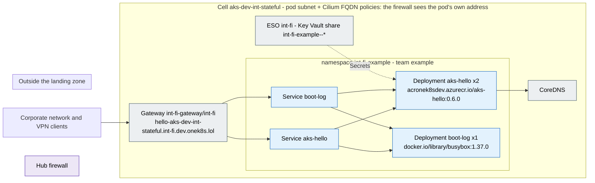

# Traffic flows of `int-fi-example`

Generated by the documentation agent of onek8s/aks-ai-agents (`aks-agent docs traffic`) from Git alone - the
application's configuration, its firewall rules in `stacks/platform-extensions/firewall-applications/dev-int/int-fi-example.yaml`,
the zone's allow-list and the cells' settings. Do not edit by hand: the next run overwrites it.

| | |
|---|---|
| Isolation zone | `int-fi` |
| Team, contact | example, https://github.com/onek8s/aks-fluxcd-example/issues |
| Configuration | [onek8s/aks-fluxcd-example / apps](https://github.com/onek8s/aks-fluxcd-example/tree/main/apps) |
| Cells | `aks-dev-int-stateful` (not running) |
| Egress model | - |

## Egress: what leaves the cluster, and who asked for it

The hub firewall's rules name the zone, not the application; the application's rule file does. Each row is
one destination with its status, the reason the rule file gives and where the application's configuration
names it.

| Destination | Port | Status | Rule | Why (from the rule) | Named in the configuration | Evidence |
|---|---|---|---|---|---|---|
| - | | nothing leaves the cluster: no rule, and the configuration names no destination | | | | |

The zone's allow-list and the platform's rules (open to every application of the zone, resp. from every cell)
are on the [zone's page](zone-int-fi.md); a name of theirs appears above only when this application's
configuration names it.

## Ingress: how it is reached

| Route | Hostnames | Gateway | Backends |
|---|---|---|---|
| `aks-hello` | `hello-aks-dev-int-stateful.int-fi.dev.onek8s.lol` | `int-fi-gateway/int-fi` | `aks-hello` |
| `boot-log` | `hello-aks-dev-int-stateful.int-fi.dev.onek8s.lol` | `int-fi-gateway/int-fi` | `boot-log` |

## Workloads

| Workload | Replicas | Images | URLs in its environment |
|---|---|---|---|
| Deployment `aks-hello` | 2 | `acronek8sdev.azurecr.io/aks-hello:0.6.0` | - |
| Deployment `boot-log` | 1 | `docker.io/library/busybox:1.37.0` | - |

## Legend

- **allowed** (green): a rule in the application's file, and the application's configuration names the
  destination - the rule has a source.
- **allowed, not in the configuration** (amber): a rule in the application's file that nothing in its
  configuration names - a dependency the configuration hides (a library, a sidecar), or a rule to remove.
- **denied: no rule** (red, dashed): the configuration names it and no rule allows it - the firewall
  denies it until the egress agent's pull request is merged.
- **proposed** (purple, dashed): in an open pull request of the egress agent.
- **zone allow-list** (teal): on the zone's allow-list, open to every application of the zone; on an
  application's page only when its configuration names it.
- **platform rule** (grey): a rule of the platform for every cell of the exposure (the registry, Grafana
  Cloud, ...); on an application's page only when its configuration names it.

A rule opens its destination to the whole zone (the firewall tells zones apart, not applications within
one - design section 5.2): the zone's page shows the union.
