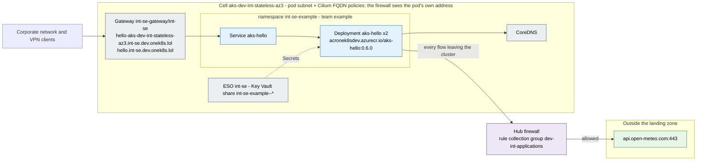

# Traffic flows of `int-se-example`

Generated by the documentation agent of onek8s/aks-ai-agents (`aks-agent docs traffic`) from Git alone - the
application's configuration, its firewall rules in `stacks/platform-extensions/firewall-applications/dev-int/int-se-example.yaml`,
the zone's allow-list and the cells' settings. Do not edit by hand: the next run overwrites it.

| | |
|---|---|
| Isolation zone | `int-se` |
| Team, contact | example, https://github.com/onek8s/aks-fluxcd-example/issues |
| Configuration | [onek8s/aks-fluxcd-example / firewall-egress](https://github.com/onek8s/aks-fluxcd-example/tree/main/firewall-egress) |
| Cells | `aks-dev-int-stateless-az3` |
| Egress model | pod subnet + Cilium FQDN policies: the firewall sees the pod's own address |

## Egress: what leaves the cluster, and who asked for it

The hub firewall's rules name the zone, not the application; the application's rule file does. Each row is
one destination with its status, the reason the rule file gives and where the application's configuration
names it.

| Destination | Port | Status | Rule | Why (from the rule) | Named in the configuration | Evidence |
|---|---|---|---|---|---|---|
| `api.open-meteo.com` | 443/https | allowed - the application's rule, named in its configuration | `dev-int-applications/int-se-example-https-443` | aks-hello fetches a weather forecast from the internet (api.open-meteo.com) as configured in firewall-egress/kustomization.yaml line 34 | Deployment aks-hello, WEATHER_URL mentioned in firewall-egress/kustomization.yaml | 91 denied connections from pods aks-hello in namespace int-se-example on cluster aks-dev-int-stateless-az3, first seen 2026-10-15T17:49:32+00:00, last seen 2026-10-15T20:47:35+00:00 |

The zone's allow-list and the platform's rules (open to every application of the zone, resp. from every cell)
are on the [zone's page](zone-int-se.md); a name of theirs appears above only when this application's
configuration names it.

## Ingress: how it is reached

| Route | Hostnames | Gateway | Backends |
|---|---|---|---|
| `aks-hello` | `hello-aks-dev-int-stateless-az3.int-se.dev.onek8s.lol` | `int-se-gateway/int-se` | `aks-hello` |
| `aks-hello-home` | `hello.int-se.dev.onek8s.lol` | `int-se-gateway/int-se` | `aks-hello` |

## Workloads

| Workload | Replicas | Images | URLs in its environment |
|---|---|---|---|
| Deployment `aks-hello` | 2 | `acronek8sdev.azurecr.io/aks-hello:0.6.0` | `WEATHER_URL`: `https://api.open-meteo.com` |

## Legend

- **allowed** (green): a rule in the application's file, and the application's configuration names the
  destination - the rule has a source.
- **allowed, not in the configuration** (amber): a rule in the application's file that nothing in its
  configuration names - a dependency the configuration hides (a library, a sidecar), or a rule to remove.
- **denied: no rule** (red, dashed): the configuration names it and no rule allows it - the firewall
  denies it until the egress agent's pull request is merged.
- **proposed** (purple, dashed): in an open pull request of the egress agent.
- **zone allow-list** (teal): on the zone's allow-list, open to every application of the zone; on an
  application's page only when its configuration names it.
- **platform rule** (grey): a rule of the platform for every cell of the exposure (the registry, Grafana
  Cloud, ...); on an application's page only when its configuration names it.

A rule opens its destination to the whole zone (the firewall tells zones apart, not applications within
one - design section 5.2): the zone's page shows the union.
