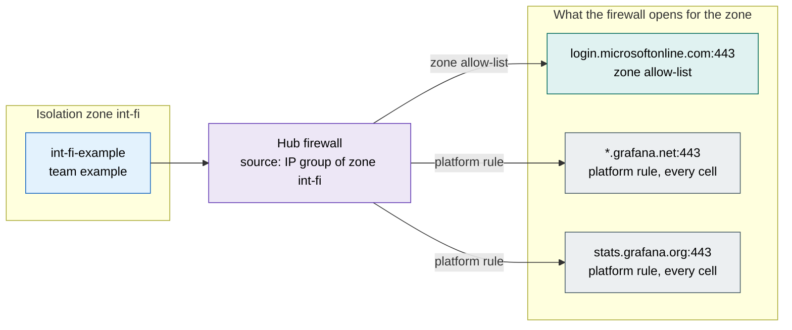

# Traffic flows of isolation zone `int-fi`

Generated by the documentation agent of onek8s/aks-ai-agents (`aks-agent docs traffic`). Do not edit by hand.

The hub firewall opens every destination below to **every application of the zone** - its rules take the
zone's IP group as their source (design section 5.2). The application pages say who asked for each one. Cells: -.

## Applications

| Namespace | Team | Rules | Of them not named in the configuration | Named, no rule |
|---|---|---|---|---|
| [`int-fi-example`](int-fi-example.md) | example | 0 | 0 | 0 |

## Destinations the zone may reach

| Destination | Port | Asked for by | Named in their configuration | Why |
|---|---|---|---|---|
| `login.microsoftonline.com` | 443 | the zone's allow-list (platform) | - | open to every application of the zone |
| `*.grafana.net` | 443 | a platform rule of the exposure | - | open from every cell: the platform's own flows |
| `stats.grafana.org` | 443 | a platform rule of the exposure | - | open from every cell: the platform's own flows |

## Legend

- **allowed** (green): a rule in the application's file, and the application's configuration names the
  destination - the rule has a source.
- **allowed, not in the configuration** (amber): a rule in the application's file that nothing in its
  configuration names - a dependency the configuration hides (a library, a sidecar), or a rule to remove.
- **denied: no rule** (red, dashed): the configuration names it and no rule allows it - the firewall
  denies it until the egress agent's pull request is merged.
- **proposed** (purple, dashed): in an open pull request of the egress agent.
- **zone allow-list** (teal): on the zone's allow-list, open to every application of the zone; on an
  application's page only when its configuration names it.
- **platform rule** (grey): a rule of the platform for every cell of the exposure (the registry, Grafana
  Cloud, ...); on an application's page only when its configuration names it.

A rule opens its destination to the whole zone (the firewall tells zones apart, not applications within
one - design section 5.2): the zone's page shows the union.
